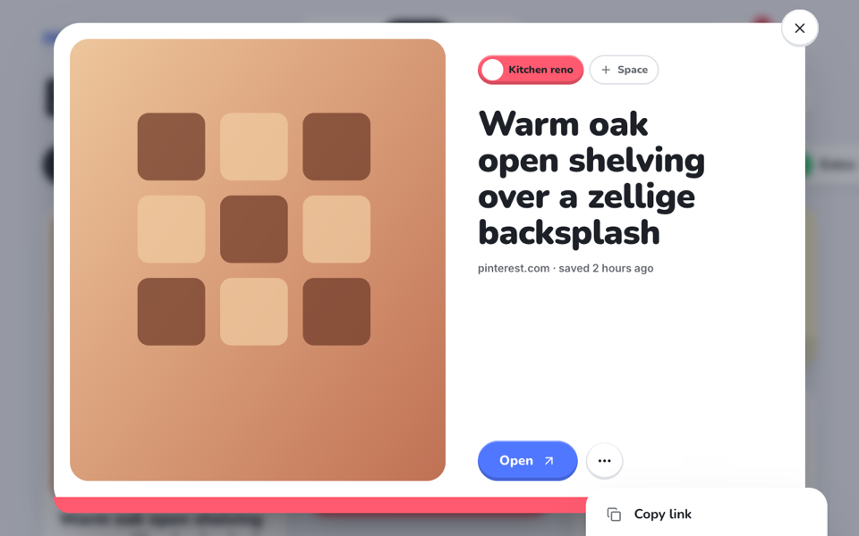
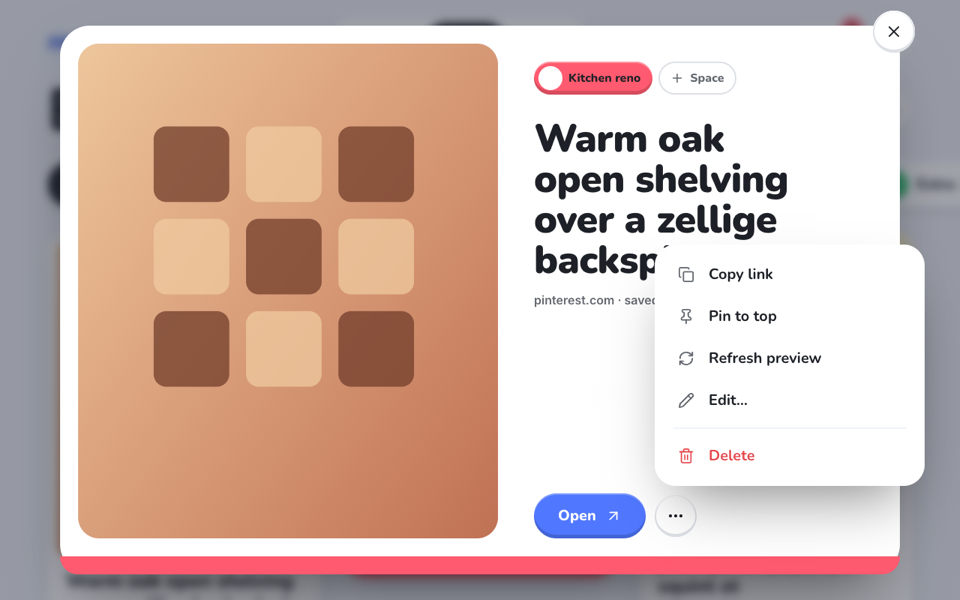
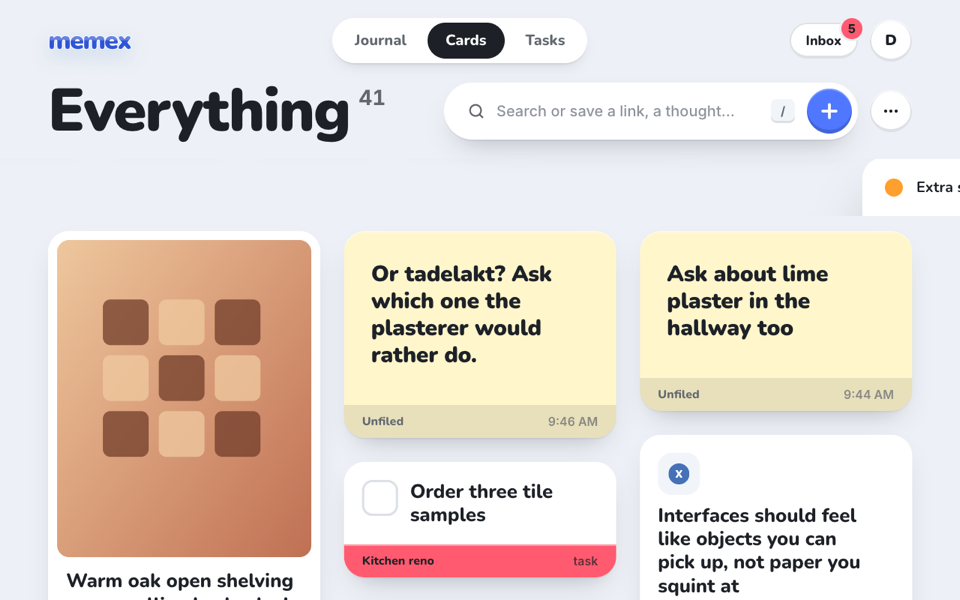
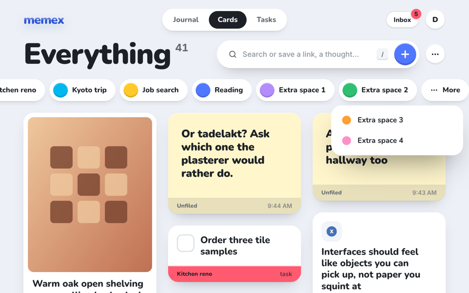

# Popovers and ••• menus

**Built 2026-11-17** after two bugs Ryan found on desktop: the open card's ••• menu ran off the bottom of the window, and the space pills' **More** menu opened behind the grid where nothing in it could be clicked.

## How they work now

Every popover and menu sits on one primitive, `src/components/cards/Popover.tsx`, positioned by Floating UI (`@floating-ui/react-dom`):

- **Placement** (`src/components/cards/popoverPlacement.ts`): the preferred side (below a ••• button, above a Journal entry's menu or the Journal composer's `@` picker), **flipped** to the other side when it doesn't fit, **shifted** to stay 16px inside the window, and if it fits on neither side, **sized** to the room on the roomier side with its content scrolling (`--mc-pop-max-h` / `--mc-pop-max-w`, which each popover's own CSS caps respect). It follows its trigger on scroll and resize (`autoUpdate`) and hides while the trigger is scrolled fully out of sight.
- **Layer**: rendered in a portal at the end of `<body>` with `position: fixed` on `--mc-z-popover` (`src/styles/cards/tokens.css`, which now lists every stacking layer), so no parent's `overflow`, `transform`, `contain` or stacking context can clip or cover it. That was bug 2: the More menu was an absolutely placed child of the pill row, whose `overflow-x: auto` clipped it.
- **Inside a sheet** (the open card, settings): sheets are modal `<dialog>`s in the browser's top layer, which make the rest of the page inert, so a popover opened in one is portalled into that dialog instead. A menu opened inside another popover (a saved view's ••• in the View panel) nests in it, so clicks in it still count as inside.
- **No shift when you move onto it** (2026-11-17, Ryan: a small jump moving from ••• into the card menu): buttons, pills, cards, tiles and task rows lift on hover with a `transform`, and a popover is anchored to its trigger's transformed box. So a trigger whose menu is open (`aria-expanded="true"`) keeps its hover look, and so does a card, tile or task row holding one (`:has([aria-expanded='true'])`); and while open the popover re-places itself every frame (`autoUpdate` with `animationFrame`), so it rides along with a press or hover transition instead of settling where the trigger was midway. Hover rules only ever change transform, shadow, colour or opacity, never size, padding, margin or borders.
- **Behaviour** stays with each caller: `cards/Menu.tsx` (the WAI-ARIA menu button: ↓/↑/Home/End, Esc closes with focus back on the trigger, Tab closes and carries on from the trigger, a click outside closes), the View panel, the Journal's entry menus and the two composers' space pickers (focus stays in the field).

On it: the open card's •••, the space pills' More, the account menu, the Cards View panel and its saved-view menus, task row menus (Tasks and space boards), the space page's •••, the note's •••, token menus in Settings, the Journal's File to… and jot ••• menus, and the `@` space pickers in the Journal composer and the Tasks add field. (The selection bar opens the Move sheet, not a popover.)

## Checking it

- `src/components/cards/popoverPlacement.test.ts` runs Floating UI's own algorithm against a fake window: opens below with room, flips above near the bottom edge, slides in from the left and right edges, flips below at the top edge, shrinks when neither side fits.
- `scripts/check-popovers.mjs` opens every one of them in headless Chrome on demo data at 1024×640, 1280×800 and 1920×1080, with triggers near each edge, and checks it is fully inside the window, on top (points inside it hit the popover, not the grid or a sheet), that Esc closes it with focus back on the trigger, and that the More menu follows its pill when the page scrolls. With a real pointer (and motion on), it hovers each menu's trigger, clicks it and moves onto the menu, and checks neither the trigger nor the menu moved: before the fix they jumped 2–6px, now 0. Before the change 11 of its checks failed; after, all 27 pass.

```bash
VITE_MEMEX_FIXTURES=1 npx vite build --mode bench --outDir /tmp/memex-fx
npx vite preview --outDir /tmp/memex-fx --port 4173
SHOTS=/tmp/popover-shots node scripts/check-popovers.mjs http://localhost:4173
```

## Before and after (demo data, 1280×800)

| | Before | After |
|---|---|---|
| Open card ••• |  |  |
| Space pills → More |  |  |
